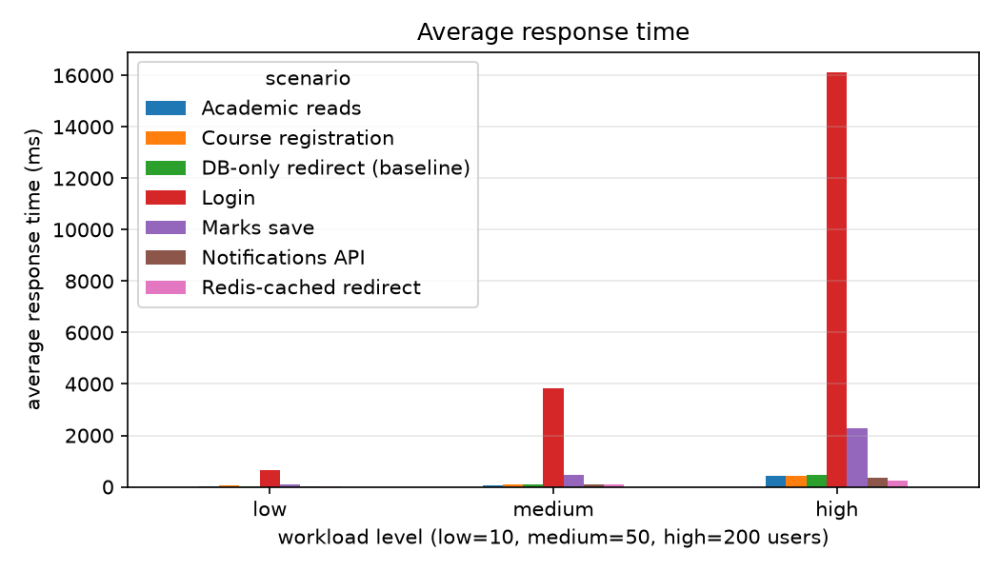
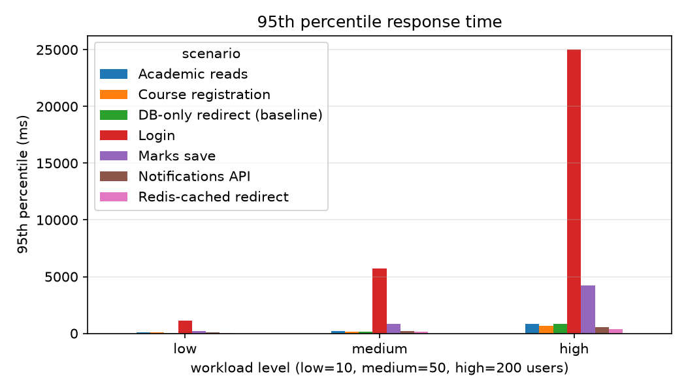
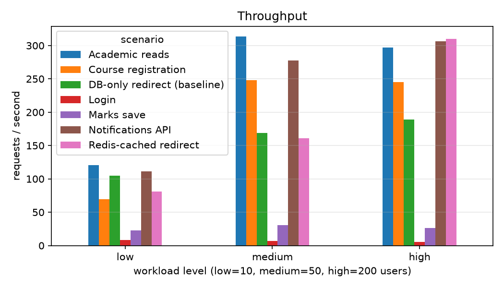
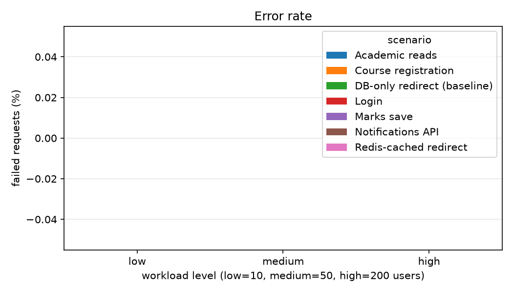
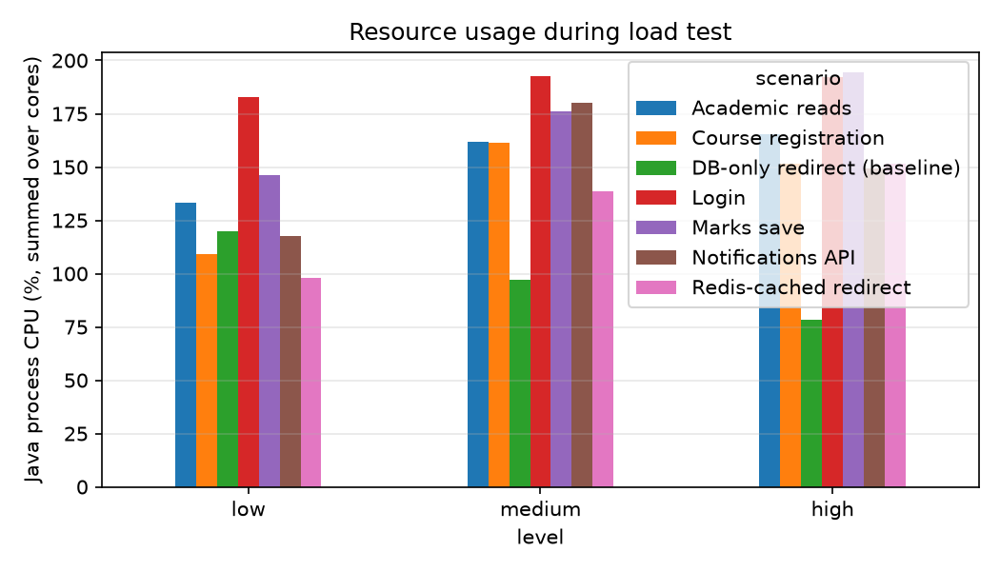
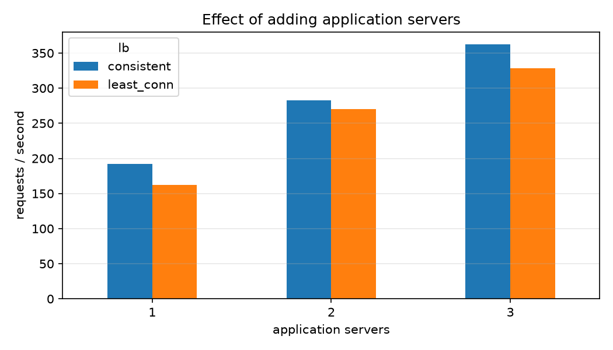
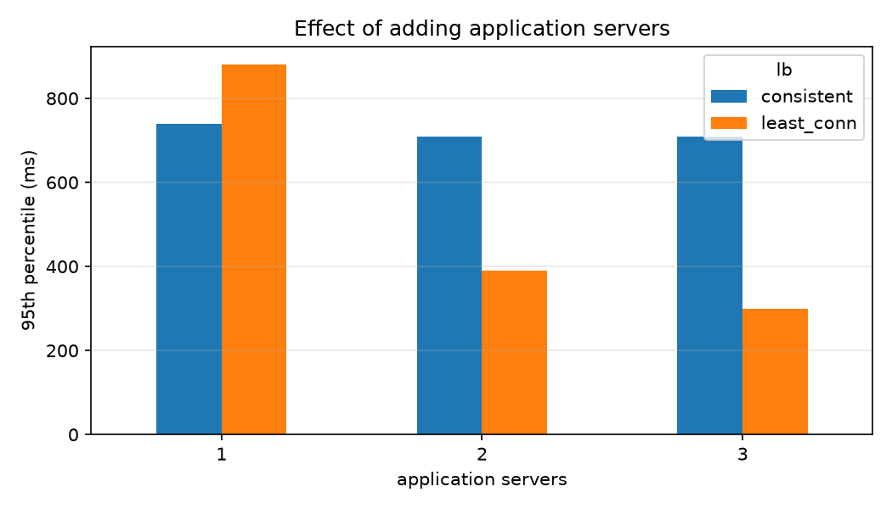
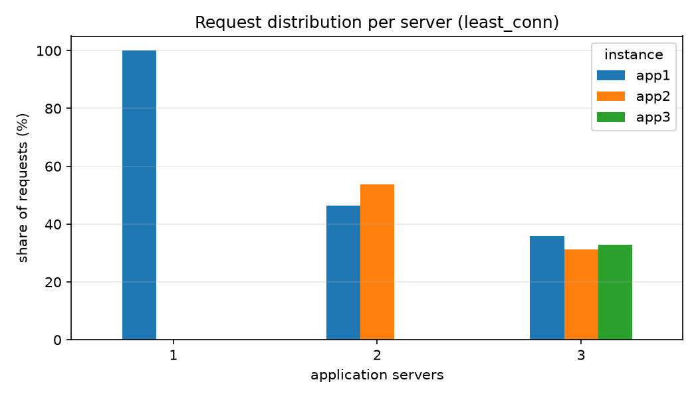
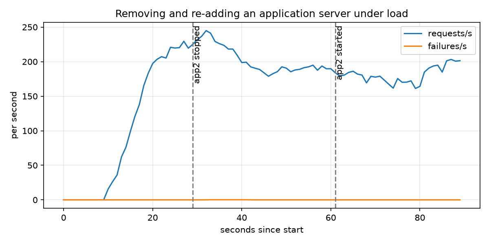

# Performance results

## Load test results

| scenario | level | users | requests | failures | error_pct | avg_ms | p95_ms | rps |
|---|---|---|---|---|---|---|---|---|
| Redis-cached redirect | low | 10 | 2289 | 0 | 0.0 | 16.9 | 36 | 81.2 |
| Redis-cached redirect | medium | 50 | 4584 | 0 | 0.0 | 83.8 | 150 | 161.0 |
| Redis-cached redirect | high | 200 | 8797 | 0 | 0.0 | 244.6 | 400 | 309.8 |
| DB-only redirect (baseline) | low | 10 | 3075 | 0 | 0.0 | 17.9 | 40 | 104.6 |
| DB-only redirect (baseline) | medium | 50 | 4705 | 0 | 0.0 | 84.2 | 150 | 168.9 |
| DB-only redirect (baseline) | high | 200 | 5665 | 0 | 0.0 | 462.0 | 810 | 189.2 |
| Notifications API | low | 10 | 3136 | 0 | 0.0 | 28.6 | 74 | 111.3 |
| Notifications API | medium | 50 | 7866 | 0 | 0.0 | 99.4 | 220 | 277.4 |
| Notifications API | high | 200 | 9163 | 0 | 0.0 | 337.9 | 570 | 306.1 |
| Academic reads | low | 10 | 3573 | 0 | 0.0 | 27.2 | 75 | 120.6 |
| Academic reads | medium | 50 | 9299 | 0 | 0.0 | 69.9 | 190 | 313.4 |
| Academic reads | high | 200 | 8812 | 0 | 0.0 | 423.9 | 820 | 296.9 |
| Course registration | low | 10 | 2051 | 0 | 0.0 | 66.1 | 100 | 69.6 |
| Course registration | medium | 50 | 7147 | 0 | 0.0 | 92.7 | 170 | 248.4 |
| Course registration | high | 200 | 7407 | 0 | 0.0 | 427.2 | 690 | 245.5 |
| Marks save | low | 10 | 662 | 0 | 0.0 | 90.7 | 220 | 22.7 |
| Marks save | medium | 50 | 907 | 0 | 0.0 | 474.2 | 850 | 31.0 |
| Marks save | high | 200 | 779 | 0 | 0.0 | 2269.5 | 4200 | 26.6 |
| Login | low | 10 | 233 | 0 | 0.0 | 655.0 | 1100 | 8.0 |
| Login | medium | 50 | 205 | 0 | 0.0 | 3843.6 | 5700 | 6.9 |
| Login | high | 200 | 152 | 0 | 0.0 | 16108.5 | 25000 | 5.2 |

   

## Resource usage

| scenario | level | avg_system_cpu_pct | avg_java_cpu_pct | max_java_rss_mb |
|---|---|---|---|---|
| Academic reads | high | 74.6 | 165.2 | 604.3 |
| Academic reads | low | 57.3 | 133.2 | 559.8 |
| Academic reads | medium | 71.2 | 161.8 | 569.8 |
| Login | high | 51.0 | 192.4 | 712.2 |
| Login | low | 53.7 | 182.7 | 706.4 |
| Login | medium | 49.1 | 192.7 | 707.6 |
| DB-only redirect (baseline) | high | 54.1 | 78.3 | 518.3 |
| DB-only redirect (baseline) | low | 56.5 | 119.7 | 533.2 |
| DB-only redirect (baseline) | medium | 49.5 | 97.3 | 516.9 |
| Notifications API | high | 71.0 | 149.3 | 537.3 |
| Notifications API | low | 45.8 | 117.7 | 523.6 |
| Notifications API | medium | 65.4 | 180.2 | 530.6 |
| Course registration | high | 66.4 | 151.6 | 619.4 |
| Course registration | low | 57.6 | 109.0 | 612.7 |
| Course registration | medium | 72.4 | 161.4 | 615.8 |
| Redis-cached redirect | high | 53.6 | 151.6 | 512.2 |
| Redis-cached redirect | low | 48.8 | 97.9 | 481.9 |
| Redis-cached redirect | medium | 52.2 | 138.7 | 488.3 |
| Marks save | high | 72.8 | 194.3 | 704.4 |
| Marks save | low | 55.7 | 146.1 | 626.5 |
| Marks save | medium | 69.1 | 176.1 | 628.7 |

## Server outcomes (registration results, rate-limiter rejections, sign-ups)

| scenario | level | outcome | count | avg_ms |
|---|---|---|---|---|
| auth | high | bad login: 401 | 23 | 11906.2 |
| auth | high | login: ok | 153 | 16057.3 |
| auth | high | signup: ok | 49 | 15362.2 |
| auth | low | bad login: 401 | 52 | 593.1 |
| auth | low | login: ok | 233 | 652.8 |
| auth | low | signup: ok | 76 | 685.7 |
| auth | medium | bad login: 401 | 32 | 3686.0 |
| auth | medium | login: ok | 205 | 3838.7 |
| auth | medium | signup: ok | 61 | 3957.0 |
| registration | high | drop FAILED, registration left in place | 2 | 134.9 |
| registration | high | drop retried (registration lock busy) | 91 | 307.2 |
| registration | high | registered | 71 | 507.5 |
| registration | high | rejected: already registered | 102 | 385.6 |
| registration | high | rejected: course full | 18 | 366.1 |
| registration | high | rejected: registration lock busy (409) | 6947 | 425.4 |
| registration | high | rejected: timetable clash | 280 | 443.3 |
| registration | low | drop FAILED, registration left in place | 1 | 18.0 |
| registration | low | drop retried (registration lock busy) | 169 | 15.9 |
| registration | low | registered | 155 | 91.1 |
| registration | low | rejected: already registered | 136 | 57.0 |
| registration | low | rejected: course full | 29 | 68.0 |
| registration | low | rejected: registration lock busy (409) | 1269 | 58.8 |
| registration | low | rejected: timetable clash | 462 | 74.5 |
| registration | medium | drop FAILED, registration left in place | 16 | 65.7 |
| registration | medium | drop retried (registration lock busy) | 413 | 52.1 |
| registration | medium | registered | 139 | 135.4 |
| registration | medium | rejected: already registered | 98 | 98.8 |
| registration | medium | rejected: course full | 23 | 97.5 |
| registration | medium | rejected: registration lock busy (409) | 6559 | 90.2 |
| registration | medium | rejected: timetable clash | 410 | 115.4 |

## Application-server scaling (nginx in front of N servers)

| lb | servers | users | duration_s | requests | failures | error_pct | avg_ms | p95_ms | rps |
|---|---|---|---|---|---|---|---|---|---|
| consistent | 1 | 100 | 60 | 11250 | 0 | 0.0 | 398.1 | 740.0 | 192.5 |
| consistent | 2 | 100 | 60 | 16674 | 0 | 0.0 | 241.8 | 710.0 | 282.9 |
| consistent | 3 | 100 | 60 | 21304 | 0 | 0.0 | 179.0 | 710.0 | 362.2 |
| least_conn | 1 | 100 | 60 | 9558 | 0 | 0.0 | 459.3 | 880.0 | 162.2 |
| least_conn | 2 | 100 | 60 | 15954 | 0 | 0.0 | 190.2 | 390.0 | 270.0 |
| least_conn | 3 | 100 | 60 | 19376 | 0 | 0.0 | 137.3 | 300.0 | 328.0 |

 

### Load per application server

| lb | servers | instance | requests | share_pct | errors5xx | mean_ms |
|---|---|---|---|---|---|---|
| least_conn | 1 | app1 | 9873 | 100.0 | 0 | 312.251 |
| least_conn | 2 | app1 | 7504 | 46.3 | 0 | 74.95 |
| least_conn | 2 | app2 | 8711 | 53.7 | 0 | 56.154 |
| least_conn | 3 | app1 | 7081 | 35.9 | 0 | 30.528 |
| least_conn | 3 | app2 | 6180 | 31.3 | 0 | 37.968 |
| least_conn | 3 | app3 | 6464 | 32.8 | 0 | 33.786 |
| consistent | 1 | app1 | 11660 | 100.0 | 0 | 279.592 |
| consistent | 2 | app1 | 9520 | 55.9 | 0 | 268.848 |
| consistent | 2 | app2 | 7514 | 44.1 | 0 | 29.391 |
| consistent | 3 | app1 | 7561 | 34.6 | 0 | 106.322 |
| consistent | 3 | app2 | 7709 | 35.2 | 0 | 203.513 |
| consistent | 3 | app3 | 6605 | 30.2 | 0 | 6.222 |

## Removing / re-adding an application server

